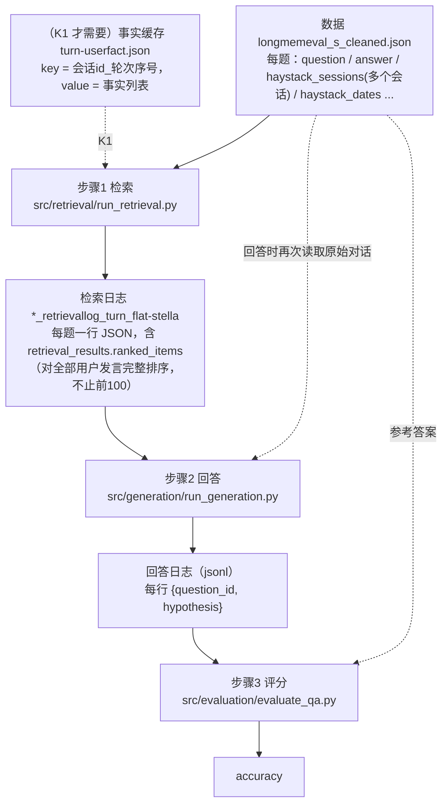
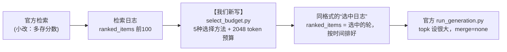

# B01 核对原论文：检索 → 回答的调用链

负责人：然　｜　任务表编号：B01　｜　完成日期：2026-10-28

> **方法说明（请先看）**
> 本文依据官方仓库 [xiaowu0162/LongMemEval](https://github.com/xiaowu0162/LongMemEval) 的源码**逐行阅读**写成，对应提交 `9e0b455f4ef0e2ab8f2e582289761153549043fc`（2026-05-11）。
> **没有实际运行过**官方检索和回答脚本（我本机无 NVIDIA GPU），所以下文的“代码行为”都来自读码，后续通过首批 5 题联调验证。（E01 已在学校 GPU 上用 Llama 跑出一次真实生成，见 `e01` 分支，但那不是官方脚本。）标“建议”的是我们项目的设计提议，不是官方事实；标“待确认”的需要组里拍板或有机器后验证。
> 引用格式：`文件:行号`，行号对应上述提交。

---

## 0. 一页看懂

官方流程分 3 步，每步一个脚本，靠**文件**传递：



三个最重要的结论：

1. **检索输出的是“全部用户发言的完整排名”**，不是前 100 条。取前 K 条是回答脚本里 `[:topk_context]` 做的（`run_generation.py:174`）。我们要的“前 100 候选”需要自己在后面截。
2. **事实只进检索、不进回答，官方就支持**：检索时 `join_mode=merge`（事实拼在用户原文前面当索引文本），回答时 `merge_key_expansion_into_value=none`（回答只读原始对话）。这正好是我们的 K1。
3. **官方回答脚本没有 token 预算**，只有“取前 k 条”和“超过模型上限才截断”。Llama 3.1 的上限设为 128000（`run_generation.py:319`），所以 2048 预算的限制完全要我们自己加。**这就是我们选择模块要插入的位置**（见第 6 节）。

---

## 1. 数据格式（输入）

文件：HuggingFace `xiaowu0162/longmemeval-cleaned` 的 `longmemeval_s_cleaned.json`（README 下载命令）。每题一个对象：

| 字段 | 含义 |
|---|---|
| `question_id` | 题号；以 `_abs` 结尾 = 拒答题（我们的主线只用可回答题） |
| `question_type` | 6 种之一（single-session-user / -assistant / -preference、temporal-reasoning、knowledge-update、multi-session） |
| `question`, `answer`, `question_date` | 问题、参考答案、提问日期 |
| `haystack_session_ids` / `haystack_dates` / `haystack_sessions` | 三个**等长、按时间排好**的列表：会话 id、会话时间、会话内容 |
| `answer_session_ids` | 证据所在会话 id（会话级评价用） |

会话内容 `haystack_sessions[i]` 是一个列表，元素是轮次 `{"role": "user"|"assistant", "content": "..."}`。**证据所在的那一句多一个 `"has_answer": true`**（README 数据格式一节）。

另有一个**很容易漏掉的细节**：证据会话的 id 本身就带 `answer_` 前缀（代码里 `if 'answer' in sess_id` 就是靠它判断，`run_retrieval.py:209, 216`）。
→ **我们自己的选择模块绝不能用 id 字符串、`has_answer` 等信息做选择**，否则等于偷看答案。这些只能用于评价（A02）。

---

## 2. 步骤 1：检索（`run_retrieval.py`）

### 2.1 怎么调用

```bash
cd src/retrieval
# K0：原文索引
bash run_retrieval.sh <数据文件> flat-stella turn
# K1：原文 + 事实
bash run_retrieval.sh <数据文件> flat-stella turn turn-userfact merge <事实缓存文件> llama-3.1-8b-instruct
```

参数顺序见 `run_retrieval.sh:8-15`：数据、检索器、粒度、扩展方法、拼接方式、缓存、辅助模型别名、输出前缀。
**注意**：缓存文件的**路径字符串里必须包含扩展方法名**（如 `turn-userfact`），否则断言失败（`run_retrieval.py:56`）。

### 2.2 建索引：什么被当成“一条记录”

粒度选 `turn` 时（`process_item_flat_index`，`run_retrieval.py:202-229`）：

- **只索引用户发言**（`role == 'user'`），助手发言不进索引。
- 每条用户发言一个 id：`<会话id>_<轮次序号>`，序号是它在会话里的位置**加 1**（从 1 开始，含助手轮次计数），例：第 0、1 条是用户和助手，则第 0 条的 id 是 `xxx_1`，下一条用户发言（位置 2）是 `xxx_3`。
- 证据会话里，**没有 `has_answer` 的用户发言 id 会把 `answer` 改成 `noans`**（`:224`），有的保留 `answer`。评价时靠 id 里有没有 `answer` 判断是不是证据（`:272`）。

### 2.3 事实增强怎么并入（K1）

`index_expansion_utils.py` 的 `resolve_expansion`：

| `join_mode` | 效果 | 对应我们的 |
|---|---|---|
| `merge` | 索引文本 = `事实 + " " + 用户原文`；**每条用户发言仍然只有一条记录，id 不变**（`:57-64`） | **K1 用这个** |
| `replace` | 索引文本只剩事实（`:65-69`） | 不用 |
| `separate` | 事实作为**额外的一条记录**，id 与原文相同（`:49-52`） | 不用（同 id 出现两次，下游会重复读同一轮） |
| `split-*` | 把多条事实拆开分别成记录 | 不用，同上 |

事实缓存的格式（`batch_expansion_turn_userfact.py:121`）：
`{ "<会话id>_<轮次序号>": ["事实句子1", "事实句子2", ...] 或 null }`，key 里**没有** `answer_`/`noans_` 前缀（读取时会被去掉，`index_expansion_utils.py:5`）。抽取失败存 `null`，检索时当空串处理（`:38`）。
事实抽取的提示词和 9 个示例写在 `batch_expansion_turn_userfact.py:21-23, 109-119`，用 Llama 3.1 8B，`temperature=0`，`max_tokens=2000`——这就是 C 线要对齐的“原作者做法”。

### 2.4 检索打分（Stella V5 1.5B）

`run_retrieval.py:83-97, 140-163`：

- 模型要**手动下载**到 `<cache_dir>/dunzhang_stella_en_1.5B_v5`，并带 `2_Dense_1024` 线性头；向量 1024 维、归一化后内积排序。
- 查询和文档都**截断到 512 token**（`:143, :154`）。
- 查询是**原始问题文本，没有加 Stella 推荐的检索指令前缀**。这是官方做法，我们为“原方法核对”就保持一致，不要改。
- **K1 的影响**：事实排在原文前面，总长超过 512 token 时被截掉的是**原文尾部**。任务表 B06 写的“核对索引编码时是否发生文本截断”指的就是这里。
- 需要 CUDA：`torch.device('cuda', gpu_id)`（`:71`），进程数 = GPU 数（`:357`）。**没有 GPU 跑不了**（我本机跑不了；学校集群可以）。

### 2.5 检索输出什么

每题写一行 JSON 到 `retrieval_logs/.../<数据文件名>_retrievallog_turn_flat-stella`（`:340`）。关键字段（`:290-315`）：

```
question_id, question_type, question, answer, question_date,
haystack_dates, haystack_sessions, haystack_session_ids, answer_session_ids,   ← 原题数据原样带上
retrieval_results:
    query: 问题文本
    ranked_items: [ {corpus_id, text, timestamp}, ... ]   ← 按相关性降序，覆盖全部用户发言
    metrics: {session:{...}, turn:{...}}                  ← recall_any/all@k、ndcg_any@k，k∈{1,3,5,10,30,50}
```

要点：
- `corpus_id` = 上面的 `<会话id>_<序号>`（证据会话可能是 `noans_` 前缀版本）。
- `text` 是**索引文本**：K0 时是用户原文；K1(merge) 时是“事实 + 原文”。**不是**最终给模型读的内容。
- **没有相关性分数字段！** 只有排名顺序，分数没存（`run_flat_retrieval` 只返回 argsort，`:196`）。
  → 任务表 B02 要求“候选带相关性分数”，以及我们的 R/MMR/C/Q 打分里的 r，**官方代码不输出**，需要我们改写（例如在 `run_flat_retrieval` 返回 scores，并存进 `ranked_items`）。这是第 6 节“必须改动处 ①”。
- 内置的 recall/ndcg 是**官方指标**，跳过拒答题和无证据题（`:396-402`）；我们的“证据保留”指标是另一套（A02）。

---

## 3. 步骤 2：回答（`run_generation.py`）

### 3.1 怎么调用

```bash
cd src/generation
bash run_generation.sh <检索日志文件> llama-3.1-8b-instruct flat-stella-turn <topk> json false con none
```

参数顺序见 `run_generation.sh:7-15`：数据/检索日志、模型别名、检索器别名、topk（默认 50）、历史格式（默认 json）、useronly（默认 false）、阅读方式（默认 con）、事实合并方式（默认 none）、后缀。
`flat-stella-turn` 会被映射成内部类型 `flat-turn`（`run_generation.sh:46-47`）。
回答模型通过**本地 vLLM 的 OpenAI 接口**（`localhost:8001`）调用，先用 `src/utils/serve_vllm.sh` 启动服务。

### 3.2 `flat-turn` 的处理流程（`prepare_prompt`，`run_generation.py:46-282`）

按顺序：

1. **建查找表**（`:74-80`）：从题目里自带的 `haystack_sessions` 再建一份 `id → 日期` 和 `id → 原始轮次`。key 同样是 `<会话id>_<序号>`。**所以回答阶段读的是原始对话，不是检索日志里的 `text`**。
2. **把检索排名转成“轮”**（`:119-131`）：对 `ranked_items` 里每一项：
   - 把 `corpus_id` 里的 `noans_` 改回 `answer_`；
   - 序号减 1 得到位置；
   - 取这条**用户发言 + 紧跟的下一条**（通常是助手回复）作为一“轮”（`cur_round_data`）。这就是我们说的“一轮对话”。
   - 找不到就静默跳过（`except: continue`）。
3. **按需带上事实**（`:133-141`）：`merge_key_expansion_into_value`
   - `none` → 只放原文这一轮（**我们要的**）
   - `merge` → 把检索日志里的索引文本（含事实）也放进提示词，另起提示词模板（`:58-62`）
   - `replace` → 只放检索日志里的索引文本
4. **取前 k 条**（`:174`）：`retrieved_chunks[:topk_context]`。**这里按“条数”而不是 token**。
5. **去掉 `has_answer`**（`:177-191`）：避免泄漏证据标记。（它是**就地修改**数据，对同一份内存数据多次使用要小心。）
6. **按日期排序**（`:225`）：`retrieved_chunks.sort(key=lambda x: x[0])`，x[0] 是日期字符串。
   - Python 排序稳定，**同一日期的轮保持相关性顺序，而不是对话先后顺序**。同一天内的多条检索结果会按“相关度”而不是“先后”出现。
   - 我们任务表写“按时间排序”，需要在 D02 里明确：日期相同的按（会话位置，轮次序号）排。
7. **拼成历史字符串**（`:227-259`）。`history_format=json` 时，每轮是：
   ```
   ### Session {i}:
   Session Date: {日期}
   Session Content:
   [{"role": "user", "content": "..."}, {"role": "assistant", "content": "..."}]
   ```
   （`flat-turn` 也写 “Session”，注释说明“目前两边都包含”，`:255`。）
8. **截断**（`:265-279`）：只有当 `history_string` 的 token 数超过 `max_retrieval_length` 才**从尾部硬截**。对 Llama 3.1：`128000 - gen_length - 1000`（`:343`），其中 `gen_length` 默认 500（`cot=true` 时 800，`:342`）。**实际上不会触发**。
9. **套提示词**（`:55-67`）。`cot=true`（对应阅读方式 `con`）的模板：“……先提取所有相关信息，再推理得出答案”，后面填 `History Chats / Current Date / Question`。
10. **调用模型**（`:357-375`）：`temperature=0`，`max_tokens=gen_length`，单条用户消息。输出一行 `{"question_id", "hypothesis"}`。

### 3.3 三个阅读方式的真实含义（容易混淆）

`run_generation.sh:62-71`：

| `READING_METHOD` | 实际参数 | 做什么 |
|---|---|---|
| `direct` | `--cot false` | 直接回答 |
| **`con`**（README 推荐，默认） | `--cot true` | **一次调用**，提示词要求“先提取相关信息，再推理” |
| `con-separate` | `--cot true --con true` | **对每个检索块先单独调用一次模型写“阅读笔记”**，再把笔记拼起来回答（`:194-222`） |

**组内已确认：主实验统一用 `con`**（PR #1 评论）：读取选中的原始对话，在**同一次生成**里先整理相关要点再回答。`con-separate` 暂不纳入主实验，上表保留仅作区别说明。

**命令行参数对应关系（请照此设置，别混淆）：**

- `run_generation.sh` 的第 7 个参数 `reading_method=con` → 脚本展开成 `--cot true`；**`--con` 不传，保持默认 `false`**。
- `--con true` 实际开启的是 **separate 流程**（对每个检索块各调一次模型写笔记），只有 `reading_method=con-separate` 才会带上它。**主实验不要开。**
- 所以名字里的 “con” 和参数 `--con` 不是一回事：前者是 `--cot true`，后者是 separate 流程开关。

选 `con` 的理由：`con-separate` 会把每一轮的原文替换成笔记（`:215`），“最终读的是原始对话”就不成立，调用次数也翻很多倍。

---

## 4. 步骤 3：评分（`evaluate_qa.py`）

- 输入：回答日志（jsonl）、数据文件（取参考答案）。
- 评分器是一个大模型，按题型用不同提示词（函数 `get_anscheck_prompt`）；**只支持三个评分模型**：`llama-3.1-70b-instruct`（本地 vLLM）、`gpt-4o-mini`、`gpt-4o`（OpenAI）（文件开头的 `model_zoo`）。
- 只回答 yes/no，`'yes' in 回答.lower()` 判对；拒答题有专用提示词。
- 这块是 F01 的任务，这里只列与调用链相关的接口：回答文件格式必须是每行 `{"question_id", "hypothesis"}`。

---

## 5. 原论文设置（我们“原方法核对”应该用的配置）

以下均来自官方 README 和脚本默认值。**原论文正文里实际用到的 topk 等数值我没有逐条核对论文**，这里只写代码和 README 能证实的。

| 项目 | 取值 | 出处 |
|---|---|---|
| 数据 | `longmemeval_s_cleaned.json`（S 版，约 40 个会话 / 约 115k token，README 称“Llama 3”口径） | README |
| 检索器 | `flat-stella`（Stella V5 1.5B） | `run_retrieval.sh` |
| 粒度 | `turn`（只索引用户发言，取回时扩成用户+紧跟的一条） | `run_retrieval.py:211`、`run_generation.py:119-131` |
| K1 事实 | `turn-userfact`，`join_mode=merge` | `index_expansion_utils.py` |
| 历史格式 | `json`（README 推荐） | README |
| `useronly` | `false`（README 推荐） | README |
| 阅读方式 | `con`（README 推荐）；`merge_key_expansion_into_value=none` | README / 脚本 |
| 回答模型 | `llama-3.1-8b-instruct`，本地 vLLM | `run_generation.sh` |
| 生成上限 | 500（`cot=false`）/ 800（`cot=true`） | `run_generation.py:342` |
| topk | 脚本默认 50 | `run_generation.sh:10` |
| 温度 | 0 | `run_generation.py:366` |

### 一次完整的“原方法”复现命令（K0）

```bash
# 0. 起回答模型服务（需要 GPU）
cd src/utils && bash serve_vllm.sh 0 llama-3.1-8b-instruct 8001 1

# 1. 检索（需要 GPU；Stella 需要先手动下载到 model_cache/dunzhang_stella_en_1.5B_v5）
cd ../retrieval
bash run_retrieval.sh ../../data/longmemeval_s_cleaned.json flat-stella turn
#   → ../../retrieval_logs/flat-stella/turn/longmemeval_s_cleaned.json_retrievallog_turn_flat-stella

# 2. 回答
cd ../generation
bash run_generation.sh \
  ../../retrieval_logs/flat-stella/turn/longmemeval_s_cleaned.json_retrievallog_turn_flat-stella \
  llama-3.1-8b-instruct flat-stella-turn 50 json false con none
#   → ../../generation_logs/flat-stella-turn/llama-3.1-8b-instruct/con/…_testlog_top50context_jsonformat_useronlyfalse_<时间>

# 3. 评分
cd ../evaluation
python3 evaluate_qa.py llama-3.1-70b-instruct <回答日志> ../../data/longmemeval_s_cleaned.json
```

K1 只改第 1 步：

```bash
bash run_retrieval.sh ../../data/longmemeval_s_cleaned.json flat-stella turn \
     turn-userfact merge <含"turn-userfact"字样的事实缓存路径> llama-3.1-8b-instruct
```
第 2 步仍用 `… con none`（`none` = 回答时不读事实）。

> 以上命令是我根据脚本**拼出来**的，**没有实际跑过**。小提醒：`bash` 脚本里 `home_dir=\`realpath ../..\`` 要求必须在对应子目录里执行（`run_retrieval.sh:5`）。

---

## 6. 需要接通的位置（我们要改什么）

### 总体思路（建议）

**不改官方回答脚本，只在检索与回答之间插一个文件级“选择器”**：



理由：官方回答脚本读的是 `retrieval_results.ranked_items` 的 `corpus_id` 列表，**只要我们输出同样格式的文件**，选中的就会被原样取用，不用改回答代码，K0/K1 之间也不会引入别的差异。

### 必须/建议改动清单

| # | 位置 | 要做的事 | 为什么 | 谁会用到 |
|---|---|---|---|---|
| ① | `run_retrieval.py:196` `run_flat_retrieval` 返回 `scores.argsort(...)` | 同时返回/保存每条的相关性分数，写进 `ranked_items` 的新字段（如 `score`） | 官方不存分数，而 R/MMR/C/Q/FL 都要 r | B02、D02–D05 |
| ② | 检索输出（`:302-309`） | 另外保存每条候选的**向量**（或能快速重算相似度的东西） | MMR、FL 要算候选两两相似度 d；官方不存 | D03、D05 |
| ③ | 新脚本 `select_budget.py` | 读检索日志，取前 100，对每个候选**还原成“用户+下一条”整轮**，用 Llama 3.1 分词器算整轮 token，按方法选到预算内，输出同格式日志 | 官方没有预算机制 | D02–D05 |
| ④ | 新脚本里的排序规则 | 输出的 `ranked_items` 直接排成**时间顺序**：先按会话在 `haystack_session_ids` 里的位置，再按轮次序号 | 回答脚本只按日期字符串稳定排序，同一天会乱序（第 3.2 节第 6 点） | D02 |
| ⑤ | 预算的计数口径 | 必须按回答脚本**实际渲染**的格式计数（`### Session i:` 头、日期、JSON 外壳都算），否则“2048”和真正喂给模型的长度对不上 | 回答脚本会额外添加这些文字（`:252-255`） | D02 |
| ⑥ | 回答脚本调用参数 | `topk_context` 设成足够大（如 1000），让它不再截；`merge_key_expansion_into_value=none` | 把“选多少”完全交给选择器 | E02 |
| ⑦ | 回答脚本 `:143-144` | **不要用 `useronly=true`**。该分支会对 `flat-turn` 报错：我用同样的数据结构复现过，`x[-1]['role']` 作用在列表上会 `TypeError: list indices must be integers` | 保持 `useronly=false` 即可（也是官方推荐值） | E02 |
| ⑧ | 保留“原方法版” | 原方法（topk=50，按条数）的结果要单独存一份，作为核对基线，与预算版分开记录 | 任务表 E02：“预算版本与原排名截取版本分别记录” | E02 |

### 不需要改的

- 回答提示词、`cot`、`json` 格式、`temperature=0`：保持官方，保证和原论文可比。
- K1 的检索：官方 `merge` 模式已满足“事实只帮检索”。

---

## 7. 已发现的坑（务必让相关同学知道）

1. **id 偏移与改名**：`corpus_id` 的序号 = 位置+1（`run_retrieval.py:217`），回答脚本再减 1（`run_generation.py:122`）；证据会话里无证据的轮 id 被改成 `noans_`，回答脚本又改回 `answer_`（`:121-122`）。**任何自己做 id 映射的代码都要保持这一套**，否则轮次会错位。（A02 的“消息-轮次-会话映射”直接相关。）
2. **id 泄漏答案**：证据会话/证据轮的 id 前缀不同。选择器、特征计算**不得读 id 字符串**。
3. **没有分数、没有向量输出**（第 2.5 节）。
4. **同一天乱序**（第 3.2 节第 6 点）。
5. **助手回复靠“下一条”取**：整轮 = 用户发言 + `位置+1` 那条，不检查它是否真是助手（`:126-128`）。若会话以用户发言结尾，则这一轮只有用户部分。
6. **索引文本 ≠ 阅读文本**：`ranked_items[].text` 在 K1 里含事实，**不要拿来当阅读材料或算 token**；阅读材料必须回到 `haystack_sessions` 取原文。
7. **512 token 截断**（K1 更容易触发，事实占位置）。
8. **静默跳过**：回答脚本里对找不到的 id 是 `except: continue`（`:130-131`），模型调用异常也只是 `continue`（`:376-378`）——**错了不会报错，只会少一题/少一轮**。批量跑时要核对输出行数（E03）。
9. **`has_answer` 就地删除**（`:182-190`）：同一进程里复用数据对象会丢标记。
10. **数据版本**：README 说 2025/09 清洗过历史会话。事实缓存如果是旧数据生成的，key 可能对不上当前数据（C01 要核对）。

---

## 8. 本文没有做的事 / 需要别人确认

| 事项 | 状态 | 谁 |
|---|---|---|
| 实际运行官方检索/回答脚本 | **没做**（我本机无 GPU；E01 已证明集群可跑 Llama） | 首批 5 题联调（G01）时验证 |
| 阅读方式 | **已确认用 `con`**（`--cot true`，`--con` 默认 false） | — |
| 官方论文正文中的 topk、预算等具体取值 | **没核对论文原文** | 有需要时再补 |
| 官方发布的事实缓存（README 的 Google Drive 链接）能否直接对上当前数据 | 没下载、没核对 | C01 |
| 如何存分数/向量（改动 ①②）的具体实现 | 只给了方案，未写代码 | B02 |

---

## 附：关键文件速查

| 想看什么 | 去哪里 |
|---|---|
| 怎么切成“一条记录”、怎么编 id | `src/retrieval/run_retrieval.py:202-229` |
| 事实怎么拼进索引 | `src/retrieval/index_expansion_utils.py:17-80` |
| Stella 打分 | `src/retrieval/run_retrieval.py:140-163, 196` |
| 检索输出格式 | `src/retrieval/run_retrieval.py:290-315` |
| 回答时 id → 原文 → 整轮 | `src/generation/run_generation.py:74-80, 119-131` |
| 取前 k、排序、拼接 | `src/generation/run_generation.py:174, 225-259` |
| 截断与长度上限 | `src/generation/run_generation.py:265-279, 315-343` |
| 提示词模板 | `src/generation/run_generation.py:53-67` |
| 事实抽取提示词与缓存格式 | `src/index_expansion/batch_expansion_turn_userfact.py` |
| 评分 | `src/evaluation/evaluate_qa.py` |
