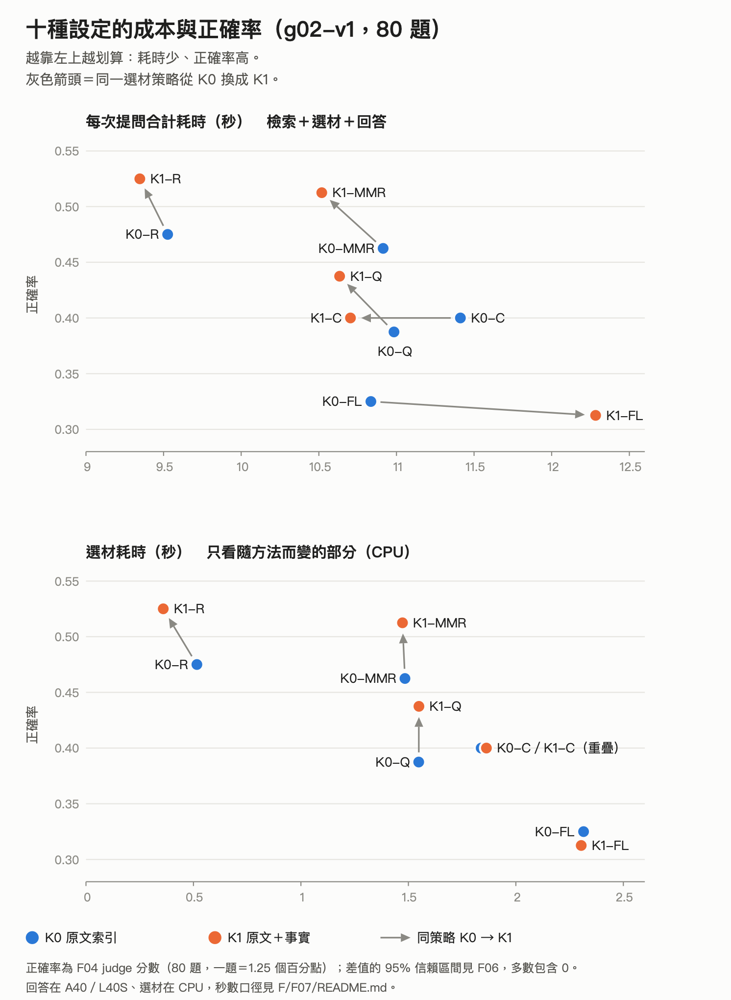

# F07 線上成本與多次複用成本（g02-v1）

80 道正式題 × 10 種設定，共 800 筆正式紀錄全部納入。成本分成三類：

- **一次性成本**：建庫。
- **每次提問成本**：檢索＋選材＋回答。
- **實驗成本**：評分，單獨列出。

複用成本照《项目解释和大纲》第 3 節計算：**總成本＝建庫成本＋T × 平均每次提問成本**。LongMemEval 每題都有自己的一份對話歷史，B04／B06 也是每題各建一次索引，所以「一份歷史」就是一題，T 是同一份歷史被提問的次數。

## 檔案

| 檔案 | 內容 |
|---|---|
| [f07_one_time.csv](f07_one_time.csv) | K0／K1 一次性成本，按階段 × 設備列出耗時和 Token：80 份合計、每份平均 |
| [f07_per_query.csv](f07_per_query.csv) | 十種設定的平均檢索、選材、回答耗時；材料／輸入／輸出 Token；截斷筆數；F04 正確率 |
| [f07_reuse.csv](f07_reuse.csv) | T = 1、10、80、100、1000 時每份歷史的總耗時，以及建庫佔比 |
| [f07_k1_vs_k0.csv](f07_k1_vs_k0.csv) | 各策略 K1 比 K0 多花的建庫時間、每段的每次提問差、正確率差 |
| [f07_e04_by_batch.csv](f07_e04_by_batch.csv) | E04 各批的 GPU、Slurm 作業、生成速度、峰值顯存、`results.jsonl` 指紋 |
| [f07_judge.csv](f07_judge.csv) | F04 評分的 Token、API 耗時、估算費用 |
| [f07_cost_vs_accuracy.svg](f07_cost_vs_accuracy.svg)／[.png](f07_cost_vs_accuracy.png) | 散點圖：每次提問耗時、選材耗時 vs 正確率，箭頭連接同策略的 K0 → K1 |



## 一次性成本（建庫）

| | K0 原文 | K1 原文加事實 |
|---|---:|---:|
| C04 事實補抽，已記錄（本機 Ollama，Llama 3.1 8B Q3_K_M） | — | 914.4 秒 |
| Stella 模型載入（A40） | 14.4 秒 | 10.1 秒 |
| Stella 歷史編碼（A40） | 953.1 秒 | 1,128.5 秒 |
| **已記錄合計（80 份）** | **967.5 秒** | **2,053.0 秒**（下限） |
| 每份歷史平均 | 12.1 秒 | 25.7 秒 |
| K1 全量抽取估計（敏感度） | — | 約 116,764 秒，每份約 1,460 秒 |

C04 只記錄了 149 個補抽事實鍵的耗時，另外 18,692 個鍵沿用作者快取，原始成本不知道。所以 K1 的已記錄成本是**下限**。全量估計的算法是：已記錄的每鍵平均 6.14 秒 × 全部 18,841 鍵，再加上 Stella 的載入和編碼時間。這是推估值，只用來看結論對這個假設敏不敏感。回答模型的載入時間（A40，352 秒）每次開跑都要花一次，只有 E04 batch-01 有紀錄，所以單獨列出，不攤進每題。

## 每次提問成本

| 設定 | 檢索（A40） | 選材（CPU） | 回答（A40／L40S） | 合計 | 正確率 |
|---|---:|---:|---:|---:|---:|
| K0-R | 0.037 | 0.52 | 8.97 | 9.53 | 0.475 |
| K0-MMR | 0.037 | 1.48 | 9.39 | 10.91 | 0.463 |
| K0-C | 0.037 | 1.84 | 9.54 | 11.41 | 0.400 |
| K0-Q | 0.037 | 1.55 | 9.40 | 10.98 | 0.388 |
| K0-FL | 0.037 | 2.32 | 8.48 | 10.84 | 0.325 |
| K1-R | 0.034 | 0.36 | 8.95 | 9.35 | 0.525 |
| K1-MMR | 0.034 | 1.47 | 9.01 | 10.52 | 0.512 |
| K1-C | 0.034 | 1.86 | 8.81 | 10.70 | 0.400 |
| K1-Q | 0.034 | 1.55 | 9.05 | 10.63 | 0.438 |
| K1-FL | 0.034 | 2.30 | 9.95 | 12.28 | 0.312 |

單位為秒。

- **回答佔每次提問的 78–96%**，約 9 秒；檢索只要約 0.03 秒。
- 選材：R 最快（0.4–0.5 秒），FL 最慢（約 2.3 秒）。Q 每題比 R 多花約 1.0–1.2 秒，比 C 少約 0.3 秒。
- 回答時間主要取決於模型寫了多長，和選材方法沒有直接關係。各設定之間差不到 1.5 秒。

## 複用：建庫什麼時候可以忽略

| 建庫佔總耗時的比例 | T = 1 | T = 100 | T = 1000 |
|---|---:|---:|---:|
| K0（各策略） | 51–56% | 約 1% | 約 0.1% |
| K1，已記錄 | 68–73% | 2–3% | 約 0.2% |
| K1，全量抽取估計 | 約 99% | 54–61% | 11–14% |

用已記錄的成本算，K1 每份歷史只比 K0 多花 **13.6 秒**，大約等於 K0 提問 1.2–1.4 次的時間。提問到 100 次時，建庫只佔總耗時的 3% 以下，兩種索引的總耗時差異主要來自每次提問的耗時。

如果把事實抽取的全部成本算進去，K1 每份歷史要多花約 **1,450 秒**，相當於提問 127–152 次的時間。這時要提問上千次，K1 的建庫成本才不再主導總成本。

正確率方面，K1 在 R、MMR、Q 都比 K0 高 5 個百分點，C 持平，FL 低 1.3 個百分點。依 F06，這幾項的 95% 信賴區間都包含 0。

## 評分（實驗成本，不計入線上成本）

F04 用 gpt-4o-2024-08-06 評了 800 筆：

- 輸入 310,877 token，輸出 1,517 token；
- API 耗時合計 689.5 秒；
- 依牌價（輸入每百萬 token 2.50 美元、輸出 10.00 美元）估算約 **0.79 美元**。

batch-05 有 95 筆被意外重評，約 0.09 美元，沒有算在內，詳見 [EVAL_NOTES.md](../EVAL_NOTES.md)。

## 口徑與限制

- **設備不同**：
  - 建庫和檢索用 A40（Stella）。
  - C04 補抽用本機 Ollama。
  - 選材用 CPU（D08）。
  - 回答用 A40，batch-07 用 L40S。

  表格保留各階段的原始秒數，合計只當參考。
- **E04 的設備**：只有 batch-01 的 `runtime.jsonl` 記錄了 GPU（A40）。其他批次依 [F05 README](../F05/g02-v1/README.md)：batch-07 用 L40S，其餘用 A40。實測 L40S 約 36.9 token／秒，A40 約 25 token／秒。同一題的十種設定都在同一批跑，所以設定之間的比較不受設備影響。`f07_per_query.csv` 另外附一欄只算 A40 批次（70 題）的回答耗時。
- **一次性成本的範圍**：沒有包含作者快取的原始抽取成本、未記錄的重試開銷，也沒有包含整批的總耗時（wall time）。C05 把這些列為未知。

## 檢查

下列任一項不符，程式就會停止：

- C05 記錄的 B04／B06 檔案指紋和實際檔案相同；
- B04／B06 逐題檢索耗時加總等於 C05；
- D08 壓縮檔指紋和交付清單相同；
- D08、E04、F04 各 800 筆，沒有重複，題目和設定完全對應；
- 三者的 `history_sha256` 逐筆一致；
- E04 沒有技術失敗，也沒有重試；
- F04 全部是 ok 或 no_answer。

另外做過以下驗證：

- 獨立重算 D08 選材耗時，結果相同；
- 少一筆、重複一筆、用含重評的 batch-05、竄改 E04 材料指紋，程式都會停止；
- 同樣輸入重跑兩次，輸出逐位元組相同。

## 輸入

- [C05 建庫成本彙總](../../C05/formal_v2_summary.json)
- [B04](../../B-检索线/B04/results/cost.json)／[B06](../../B-检索线/B06/results/cost.json) 逐題檢索耗時
- [D08 交付](../../D/D08/delivery/README.md)：8 個壓縮檔裡的 `selections.jsonl`，每筆都有 `selection_elapsed_s`
- E04 `results.jsonl`：在分支 `e04-results` 的 commit `95438df`，不在 main
- [F04 評分](../scores/)：團隊歸檔的 8 批

## 重現

在 repo 的 `F/` 目錄執行，不需要 API。輸出和本目錄的檔案逐位元組相同。

```bash
git fetch origin
```
```bash
mkdir -p /tmp/e04 && git archive 95438df E/E04/results/g02-v1 | tar -x -C /tmp/e04
```
```bash
python src/evaluation/f07_cost.py --e04-dir /tmp/e04/E/E04/results/g02-v1 --scores scores/formal_g02-v1_batch-0{1,2,3,4,5,6,7,8}.jsonl --out-dir F07
```

散點圖（只用 Python 標準庫，輸出 SVG）：

```bash
python src/evaluation/f07_plot.py --per-query F07/f07_per_query.csv --out F07/f07_cost_vs_accuracy.svg
```

PNG 版由 macOS 的 `sips -s format png -Z 2040 f07_cost_vs_accuracy.svg --out f07_cost_vs_accuracy.png` 轉出。

程式：[f07_cost.py](../src/evaluation/f07_cost.py)、[f07_plot.py](../src/evaluation/f07_plot.py)
