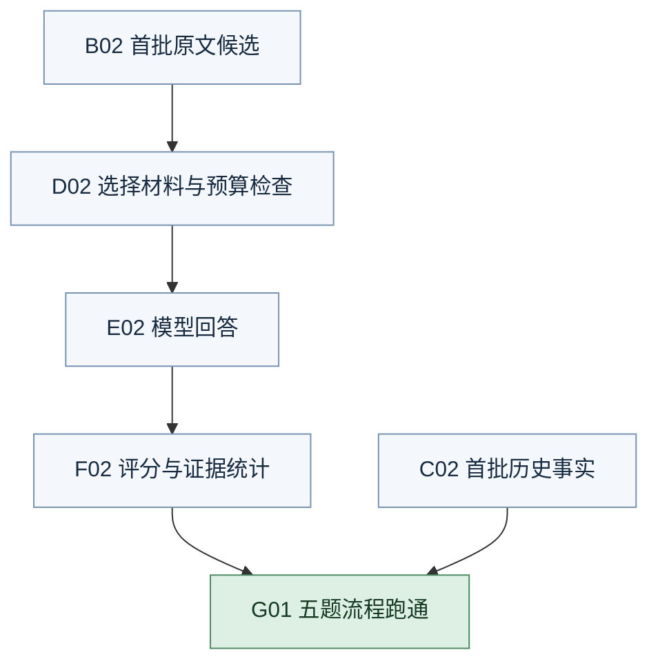
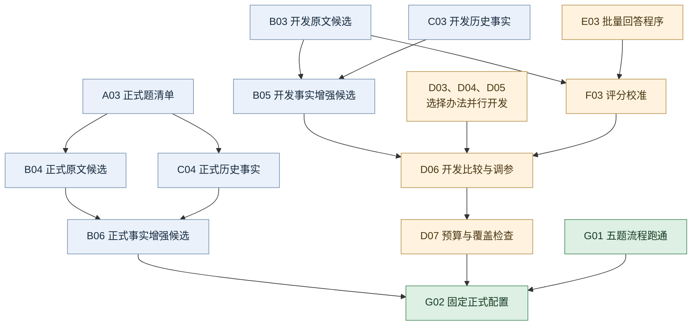
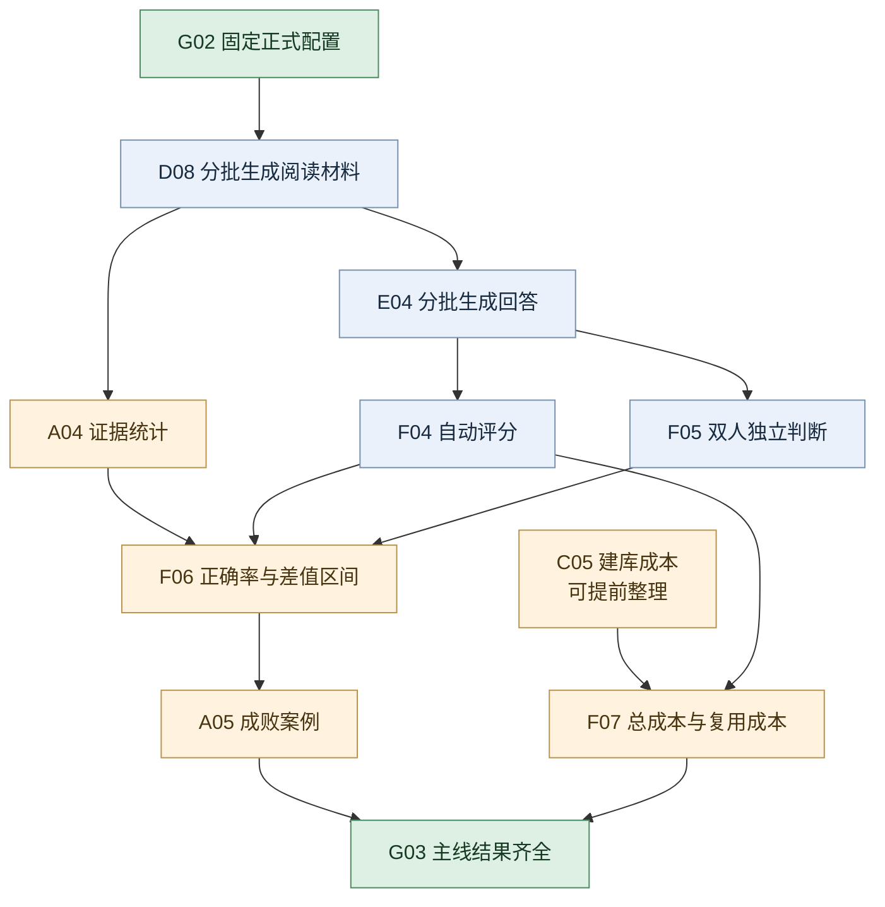

# 长期对话记忆项目待办清单

## A 数据与证据任务

| 编号 | 任务内容 | 前置任务 | 完成标准 | 补充说明 |
| --- | --- | --- | --- | --- |
| **A01** | **确定开发题与统一交接格式** 整理已有开发题清单，选出首批5题，确定题目、候选、选中材料、回答和评分的交接字段。 | 无 | 交出完整开发题编号、首批5题编号和格式样例；题号、索引、策略、轮次、消息与配置版本可以对应。 | 原文索引记为K0，原文加事实记为K1；正式比较两种索引与五种选择办法。参考答案与证据标记放在独立评价数据中。 主动投入初估1小时，另留25%缓冲。 |
| **A02** | **核对官方证据与原始消息的对应关系** 整理每题的官方证据标注，建立消息、对话轮次和会话之间的映射，计算证据保留指标。 | 无 | 交出可运行的映射与计数程序，并用开发样例核对“留下部分证据”和“留下全部证据”两种情况。 |  |
| **A03** | **确定正式题清单** 检查题目使用记录、题型和共享证据情况，选择正式可回答题，目标80道。 | A01 A02 | 交出正式题编号、实际题数、题型分布、证据相关分组及排除原因，开发题与正式题分别保存。 |  |
| **A04** | **统计正式候选与选中材料的证据** 按批次统计两种索引有没有找齐证据，以及五种选择办法有没有把证据留下。 | G02 D08 | 每题十种设置都有消息级证据保留率和证据齐全标记，并区分候选缺失、预算不足和选择遗漏。 |  |
| **A05** | **整理代表性成败案例** 比较改善、退步、证据增加但仍答错的题目，整理问题、关键原文、选择变化与答案变化。 | A04 F06 | 交出覆盖上述情形的案例，逐例能够追溯到题号、原始轮次、选择结果和最终评分。 | 按“没找到、放不下、没选到、选到仍答错”分类；在已有结果中选择案例，保留有利与不利情形。 |

## B 检索任务 与A及C—F并行

| 编号 | 任务内容 | 前置任务 | 完成标准 | 补充说明 |
| --- | --- | --- | --- | --- |
| **B01** | **核对原论文检索到回答的调用链** 阅读官方代码与项目适配，确认检索排序如何映射回原始对话，并进入实际回答程序。 | 无 | 交出调用关系、采用的原论文设置、需要接通的位置和原方法核对配置。 |  主动投入初估1.5小时，另留25%缓冲。 |
| **B02** | **生成首批5题原文候选** 接入原文索引检索，从首批开发题的历史用户发言中分别取排名前100条候选。 | A01 B01 | 5题都有候选编号、相关性分数、排名和完整原始轮次映射，回答程序可以直接读取。 | 检索优先使用Stella V5 1.5B。索引使用用户发言，返回材料保留用户发言及对应助手回复；一轮对话作为一个选择单元。 主动投入初估1.5小时，另留25%缓冲，模型运行与排队时间另计。 |
| **B03** | **生成全部开发题的原文候选** 沿用B02的检索路径，处理开发题清单中的其余题目，保存候选与配置。 | B02 | 全部开发题的K0候选齐全，编号和格式与首批5题一致。 | 输入：A01开发题清单。供D06选择参数使用；同一索引下五种选择办法共用同一份候选。 主动投入初估1小时，另留25%缓冲，模型运行与排队时间另计。 |
| **B04** | **生成正式题的原文候选** 按正式题清单建立K0候选，记录原文编码、索引构建和检索消耗。 | A03 B02 | 全部正式题的候选、原始轮次映射、版本和耗时齐全。 | 输入：A03正式题清单。此时只准备候选；正式答案生成与证据结果分析在G02固定设置后开展。 主动投入初估1小时，另留25%缓冲，模型运行与排队时间另计。 |
| **B05** | **生成开发题的事实增强候选** 把用户原文与对应历史事实组成K1索引，检索开发题的前100条候选。 | B03 C03 | 全部开发题的K1候选齐全，命中后返回与K0相同定义的完整原始轮次。 | 候选及排名可以与K0不同；去重和线索匹配仍使用原始对话。事实只参与索引。 主动投入初估1.5小时，另留25%缓冲，模型运行与排队时间另计。 |
| **B06** | **生成正式题的事实增强候选** 用正式历史的原文与事实建立K1索引，生成全部正式题候选并保存构建和检索记录。 | B04 C04 | 全部正式题的K1候选、事实来源映射、完整原文和成本记录齐全。 | 输入：C04事实和A03题目清单。核对索引编码时是否发生文本截断，保留失败与复用记录。 主动投入初估1.5小时，另留25%缓冲，模型运行与排队时间另计。 |

## C 事实任务 与A—B及D—F并行

| 编号 | 任务内容 | 前置任务 | 完成标准 | 补充说明 |
| --- | --- | --- | --- | --- |
| **C01** | **核对已有事实缓存能否复用** 检查作者或项目已有事实与当前清洗数据的对应关系，统计可复用项和缺失项。 | 无 | 交出复用清单、历史来源映射样例、缺失处理办法和整体抽取量估计。 | 事实增强指从历史用户发言提取个人事实，再加入检索索引。核对数据版本、重复会话编号和消息位置。 主动投入初估1.5小时。 |
| **C02** | **准备首批5题的历史事实** 复用已确认的缓存，补抽首批5题所涉及完整历史中的事实。 | A01 C01 | 首批历史的事实、来源、失败记录、输入输出用量和时间可供检索程序读取。 | 抽取只读取历史用户发言。优先使用Llama 3.1 8B Instruct；候选检索前处理历史，问题与参考答案用于各自后续环节。 主动投入初估1小时，模型运行与排队时间另计。 |
| **C03** | **补齐其余开发题的历史事实** 按相同抽取规则补齐开发题涉及的历史，按历史内容复用已有事实。 | C02 | 全部开发历史有事实或明确失败记录，能够直接建立开发K1索引。 | 输入：A01开发题清单及C02抽取配置；规则与输出格式保持一致。 主动投入初估1.5小时，另留25%缓冲，模型运行与排队时间另计。 |
| **C04** | **补齐正式题的历史事实** 处理正式题所涉及的完整历史，补齐事实及来源并记录实际消耗。 | A03 C02 | 全部正式历史的事实、缓存复用、失败与消耗齐全，B06可以接入。 | 处理范围按历史确定，覆盖检索前的所有记录；新抽取成本与缓存复用分别记账。 主动投入初估2小时，模型运行与排队时间另计。 |
| **C05** | **检查事实质量与一次性建库成本** 按固定抽样规则核对事实是否忠实于原文，汇总事实抽取、编码和索引构建的实际开销。 | B04 B06 C04 | 交出质量抽查、事实失败率、实际调用量和两种索引的一次性成本表。 | 同一份事实被五种策略复用时只记一次构建成本；缓存旧抽取成本未知的项保留相应记录。可与正式回答、评分并行。 主动投入初估1.5小时。 |

## D 选择任务 与A—C及E—F并行

| 编号 | 任务内容 | 前置任务 | 完成标准 | 补充说明 |
| --- | --- | --- | --- | --- |
| **D01** | **核对现有五种选择办法与接口** 检查已有选择代码、小例子和运行器，列出可复用实现及需要接入或补齐的部分。 | 无 | 交出五种方法的实现清单、统一输入输出接口和小例子结果。 | 五种方法为相关性R、最大边际相关性去重MMR、兼顾长度C、线索覆盖Q、设施选址式集合覆盖FL；现有批量运行器默认只接入三项。去重和线索特征统一基于原始轮次。 主动投入初估1小时 |
| **D02** | **接入相关性选择与统一预算检查** 按相关性排名选择完整轮次，放不下的记录跳过；统一材料拼接、时间排序和长度计算。 | B02 D01 | 首批5题有可直接阅读的材料，最终拼接长度通过检查，超长轮次与停止情况有记录。 | Token是模型计量文本长度的单位。主预算先以2048 Token开发验证；回答输出额度单独设置。材料与成本计数使用回答模型对应的分词器。 主动投入初估1.5小时 |
| **D03** | **完成去重选择办法** 实现最大边际相关性去重：优先相关、且与已选内容相似度较低的记录。 | D02 | 去重办法可接收真实候选，保存权重、选中记录和每一步分数。 | 打分为`r − λd`；r是相关性，d是与已选原文的最大相似度，λ控制去重。与D04、D05并行开发。 主动投入初估1.5小时 |
| **D04** | **完成兼顾长度与问题线索覆盖** 实现成本对照C和覆盖办法Q，从问题自动提取词面线索，并记录新覆盖的线索。 | D02 | 两种方法可运行；覆盖奖励可关闭；规则、参数和选择过程可保存。 | C为`(r − λd) / c`，Q为`(r − λd + γg) / c`；c是新增Token成本，g是新覆盖线索，γ控制奖励。与D03、D05并行。 主动投入初估2小时 |
| **D05** | **完成已有集合覆盖对照** 实现相关性加权的设施选址式选择，按每增加一条记录带来的覆盖收益与成本之比挑选。 | D02 | 方法可运行，目标公式、相似度、停止规则、来源及适配方式有记录。 | 参考[PACMS](https://arxiv.org/abs/2606.20047v1)。与其他办法共用候选、完整原文和预算；与D03、D04并行。 主动投入初估2小时 |
| **D06** | **开展开发比较并选择参数** 在开发题上运行两种索引与五种选择办法，按统一标准为各方法选择参数。 | B03 B05 D03 D04 D05 E03 F03 | 至少5道开发题完成十种设置；交出完整开发结果、计分范围、并列处理、停止规则和参数选择依据。 | C与Q分别公平调参。保持同一阅读模型和评价规则，允许最优去重或覆盖权重为零。 主动投入初估2小时，模型运行与排队时间另计。 |
| **D07** | **检查预算变化与覆盖奖励** 复用候选，在较小和较大预算下统计证据；固定Q其他参数后关闭覆盖奖励。 | A02 D06 | 交出不同预算的证据保留表，以及关闭覆盖奖励的同题比较。 | 额外预算可先取1024与4096 Token；本任务主要复用选择与证据程序。主预算和正式比较范围在G02确定。 主动投入初估1.5小时 |
| **D08** | **分批生成正式阅读材料** 按固定配置，为每批正式题生成两种索引与五种办法的全部阅读材料。 | G02 | 每题十种材料齐全，题号、索引、策略、原文轮次与实际长度对应，最终预算通过检查。 | 每批约10题，80题对应800份材料记录。交一批即可启动E04与A04；保存实际文本及输入配置。主动投入初估每批1小时 |

## E 回答任务 与A—D及F并行

| 编号 | 任务内容 | 前置任务 | 完成标准 | 补充说明 |
| --- | --- | --- | --- | --- |
| **E01** | **验证回答模型与运行环境** 检查模型访问、设备环境和一次真实开发材料的生成，测量初步速度与用量。 | 无 | 交出模型版本、运行配置、真实输出、保存位置、耗时及输入输出Token记录。 | 优先使用Llama 3.1 8B Instruct；计算优先使用学校图形处理器（GPU），Google Colab Pro补充。模型作业按可用设备排队。 主动投入初估1.5小时，模型运行与排队时间另计。 |
| **E02** | **生成首批5题回答并核对原阅读方式** 读取D02材料，按原论文先整理相关要点再回答的流程生成答案，并核对原方法排名截取设置。 | D02 E01 | 保存5题预算版本的实际输入、完整输出、提取答案和消耗；原方法核对记录可追溯。 | 核对输出上限、结构化答案解析和截断；预算版本与原排名截取版本分别记录。 主动投入初估1小时，模型运行与排队时间另计。 |
| **E03** | **接通批量回答与恢复运行** 支持按题目、索引和策略批量生成，保存中间结果并从中断处继续。 | E02 | 批量程序可运行，保存输入与配置标识，识别技术失败、重复输入和输出截断。 |  主动投入初估1.5小时，模型运行与排队时间另计 |
| **E04** | **分批生成正式回答** 持续读取D08已交付的材料，按固定生成配置完成全部正式回答。 | D08 E03 | 每份材料有原始回答、提取答案、输入输出用量、耗时及失败处理记录。 | 按对应批次依赖执行，首批结果产生后即可启动F04、F05。每批约10题；主动投入初估每批0.5小时 |

## F 评价与成本任务 与A—E并行

| 编号 | 任务内容 | 前置任务 | 完成标准 | 补充说明 |
| --- | --- | --- | --- | --- |
| **F01** | **整理官方评分规则与初版评分程序** 阅读官方任务评分办法，用已有开发回答核对规则，接入可保存结果的评分程序。 | 无 | 交出任务评分规则、评分模型初选、答案提取要求和可运行样例。 | 参考答案由官方提供；评分时使用问题、参考答案和模型回答，方法名称隐藏。 主动投入初估1.5小时 |
| **F02** | **完成首批5题评分与证据统计** 对首批回答评分，并把候选、选中材料、官方证据与答案串联起来。 | A02 E02 F01 | 5题均有评分与证据指标，发现的映射、解析和评分问题有记录。 | 输入：B02候选、D02材料和E02输出。用于G01全流程核对。 主动投入初估1小时，另留25%缓冲。 |
| **F03** | **校准正式评分配置** 整理约20—40条开发回答，对照人工判断检查自动评分、答案提取和分歧处理。 | B03 E03 F02 | 固定评分模型版本、运行配置、判分与分歧处理规则，保存校准样例和结果。 | 可先用开发原文候选及相关性选择生成样例；沿用已有开发输出时记录其来源和设置。开发参数比较使用校准后的同一套评分。 主动投入初估1.5小时，另留25%缓冲，模型运行与排队时间另计。 |
| **F04** | **分批自动评分正式回答** 按固定评分配置处理E04输出，保存逐条评分和评分消耗。 | E04 F03 | 每条正式回答有评分、判分记录和配置标识，缺失与技术失败均可追踪。 | 按对应批次依赖执行；技术失败按G02固定规则处理。主动投入初估每批0.5小时，另留30%缓冲，机时另计。 |
| **F05** | **分包独立判断匿名回答** 对至少20%的去重正式回答进行双人独立判断，记录分歧并完成处理。 | E04 F03 | 抽取数量达到约定比例；每条被抽取回答有两份独立判断与最终处理结果。 | 每包约15—20条，由不同成员分别领取两份判断任务；先独立判断，再核对分歧。可与F04并行；每包每人初估1小时 |
| **F06** | **计算主结果与差值区间** 汇总十种设置正确率、同题改善和退步、覆盖增量、事实增量及交互变化。 | A04 F04 F05 | 交出主结果表、主要配对差值和95%置信区间，正式题与记录数量核对一致。 | 等待所有正式批次及人工抽查完成。Q0/C0为K0下两种办法的正确率，Q1/C1为K1下正确率；交互为`(Q1 − C1) − (Q0 − C0)`。按题配对，共享证据题按组计算区间；80题时每题对应1.25个百分点。 主动投入初估2小时 |
| **F07** | **汇总在线成本与多次复用成本** 合并检索、选择、回答和评分记录，将一次性建库与每次提问开销分开比较。 | C05 D08 E04 F04 | 全部正式记录纳入成本表，阶段、设备、调用量、Token与耗时口径一致，并给出不同复用次数的成本。 | 总成本为“建库成本＋查询次数×平均每次查询成本”；评分单列为实验成本。可边运行边汇总，全部批次齐全后完成整项任务。 主动投入初估1.5小时|

## G 联调与主线完成

| 编号 | 任务内容 | 前置任务 | 完成标准 | 补充说明 |
| --- | --- | --- | --- | --- |
| **G01** | **确认首批5题完整流程与规模估计** 联查首批开发题的检索、选择、回答、评分和证据，同时核对事实样例与运行速度。 | B02 C02 D02 E02 F02 | 交出5题全流程记录、待修问题、事实抽取和生成速度，以及正式规模初步估算。 | 可依据B—F已交产物联查；估算覆盖完整历史处理、开发运行、正式回答和评分。 主动投入初估1小时 |
| **G02** | **固定正式配置与执行清单** 汇总正式输入、开发参数、阅读与评分配置，确定正式题数、预算及技术失败处理办法。 | A03 B04 B06 D06 D07 E03 F03 G01 | 交出固定配置、正式清单、两套候选、参数及运行入口；后续十种设置使用同一版配置。 | 主线为K0/K1×R/MMR/C/Q/FL。两套候选的构建可提前完成；本任务完成后启动正式材料、回答和评价。 主动投入初估1小时 |
| **G03** | **核对主线结果与可追溯记录** 核对题目、输入、配置、材料、回答、评分、证据、成本和案例之间的对应关系。 | A05 C05 F06 F07 | 主线结果齐全，所有缺失、失败和补跑有记录，另一位组员可按保存配置读取并复查结果。 | 交付包括代码版本、结果总表、逐题记录与案例。核对范围为实验记录和研究结果。 主动投入初估1小时|

## H 扩展任务

| 编号 | 任务内容 | 前置任务 | 完成标准 | 补充说明 |
| --- | --- | --- | --- | --- |
| **H01** | **试验结构化选择** 把历史事件、时间、地点和属性关联起来，固定K1候选比较词面选择与结构化选择。 | G03 | 完成20—30道开发题比较，交出字段规则、抽取质量、证据、答题和额外成本结果。 | 优先级：后续提升。比较兼顾长度C、词面覆盖Q与结构化覆盖；例如区分搬出地和目的地。启动时先细分字段抽取、匹配和运行任务。 |
| **H02** | **试验结构化索引** 把同一批结构字段加入索引，比较是否加字段与是否用结构化选择的四种组合。 | H01 | 正式比较范围与题目提前确定，四条件结果能够区分检索变化与选择变化。 | 优先级：后续提升。阅读材料继续使用完整原始轮次；同一事实内容与字段规则在四个条件中保持对应。 |
| **H03** | **增加其他预算下的完整问答** 选定额外阅读预算，复查主要效果是否随阅读空间变化。 | G03 | 比较范围和参数事先确定，交出新增预算的正确率、证据与成本。 | 优先级：有时间再做。D07只做选择与证据诊断；本任务增加完整回答与评分。 |
| **H04** | **使用第二个回答模型复查** 选择第二个回答模型，固定其他条件，复查主要发现是否依赖原回答模型。 | G03 | 交出固定模型版本、相同题目上的主要对比、证据与新增成本。 | 优先级：有时间再做。先确定待复查的主要结论和对比范围，再估算实际调用量。 |
| **H05** | **扩大正式样本** 检查额外题目的使用记录和共享证据情况，按固定方法增加测试样本。 | G03 | 新增清单与选择规则固定，新增题覆盖同一组比较，主结果与差值区间更新完整。 | 优先级：有时间再做。沿用A03的数据审计及G02的主要方法配置。 |
| **H06** | **单独研究正确拒答** 整理无法从历史回答的问题，检查模型是否能正确拒答，并独立统计。 | G03 | 交出拒答题来源、固定评分规则、正确拒答率和代表性案例。 | 优先级：有时间再做。与可回答题分开；拒答题不套用有证据题的证据保留率。 |

## 核心任务依赖关系树状图

### 1 首批5题流程

### 2 正式输入与参数准备

### 3 正式运行与结果汇总

